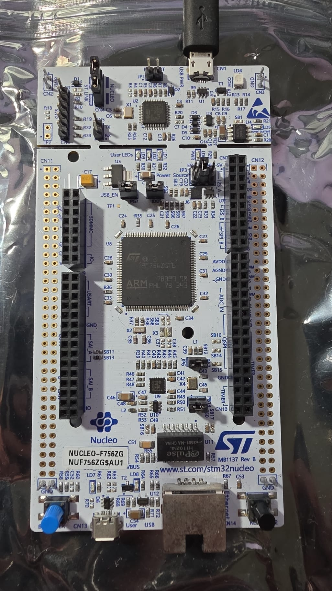
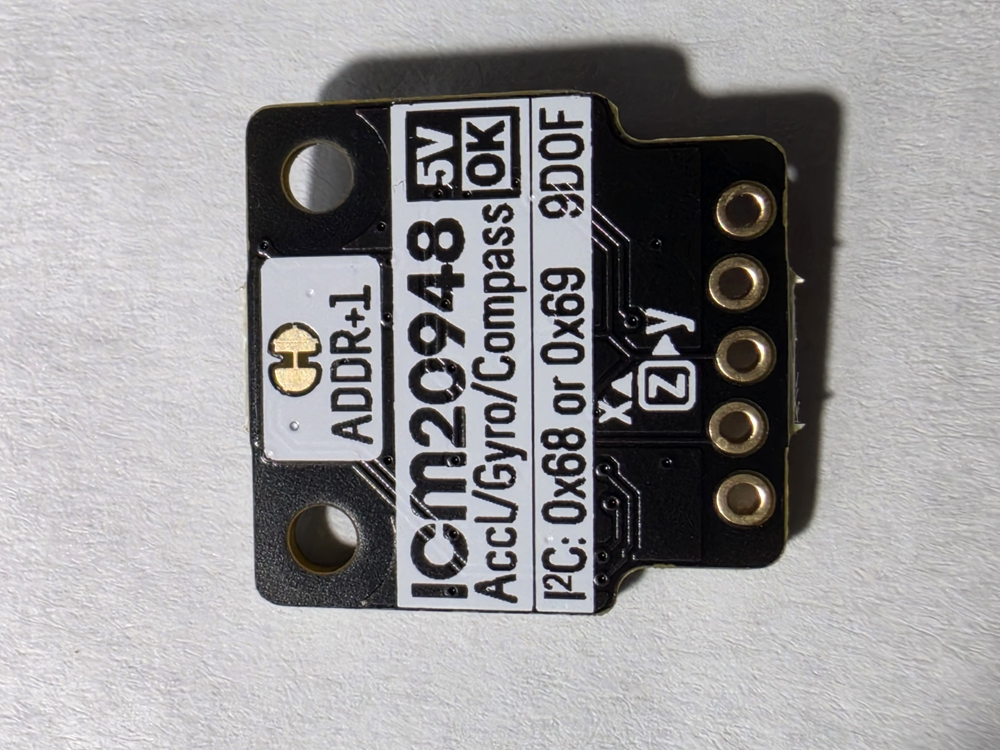
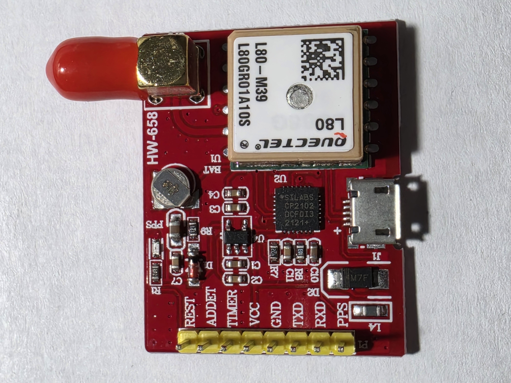

# Architectural Design Decisions

This document records the main architectural and design decisions of the STM32 Road Impact Detector project.

Its purpose is to explain **why** a solution was selected. Peripheral settings and implementation details belong in the source code and dedicated technical documentation.

## Project Scope

The system detects road impact events and associates them with GNSS position and time data.

It does not attempt to classify an event as a pothole, speed bump, road joint, or another specific road feature. Reliable semantic classification would require additional sensing and processing, such as a camera and image analysis, which are outside the embedded focus of this project.

The project therefore concentrates on:

- Real-Time Sensor Acquisition
- Impact Candidate Detection
- Accurate Event Timestamps
- GNSS Position Acquisition
- FreeRTOS Synchronization and Inter-Task Communication
- Embedded Diagnostics and Fault Handling

## Target Hardware

The target platform is the NUCLEO-F756ZG development board with an STM32F756ZGT6 microcontroller.

The board provides sufficient processing and memory resources, multiple communication peripherals, 32-bit timers, an integrated ST-LINK debugger, and a Virtual COM Port. This makes it suitable for demonstrating a realistic RTOS-based embedded system without requiring a custom PCB.

The project uses real sensors rather than simulated data:

- Pimoroni ICM-20948 breakout board for motion acquisition
- Quectel LC86G-LA GNSS module on an HW-658 development board

Additional views:

- [ICM-20948 breakout board — back](Images/icm-20948-breakout-back.jpg)
- [Quectel LC86G-LA GNSS development board — back](Images/quectel-l80-gnss-board-back.jpg)

Although the GNSS module shield is marked `L80-M39`, its boot output identifies
the installed receiver as `LC86G-LA` running firmware
`LC86GLANR01A03S` dated 2022-07-01. The firmware uses the Quectel PAIR command
protocol rather than the PMTK command set associated with the L80 family.

Real hardware exposes practical embedded-development problems that simulated input does not reproduce: device initialization, electrical interfaces, communication failures, asynchronous data arrival, sensor noise, and timing uncertainty.

Relevant documentation:

- [NUCLEO-F756ZG product page](https://www.st.com/en/evaluation-tools/nucleo-f756zg.html)
- [UM1974 — STM32 Nucleo-144 boards user manual](https://www.st.com/resource/en/user_manual/dm00244518-stm32-nucleo-144-boards-mb1137-stmicroelectronics.pdf)
- [STM32F756ZG product page](https://www.st.com/en/microcontrollers-microprocessors/stm32f756zg.html)
- [STM32F756xx datasheet](https://www.st.com/resource/en/datasheet/stm32f756zg.pdf)
- [RM0385 — STM32F75xxx/STM32F74xxx reference manual](https://www.st.com/resource/en/reference_manual/rm0385-stm32f75xxx-and-stm32f74xxx-advanced-armbased-32bit-mcus-stmicroelectronics.pdf)
- [ICM-20948 product page and datasheet](https://www.invensense.tdk.com/en-us/products/9-axis/icm-20948/)
- [Pimoroni ICM-20948 breakout board](https://shop.pimoroni.com/products/icm20948)
- [Quectel LC86G Series Hardware Design V1.1](https://quectel.com/content/uploads/2024/02/Quectel_LC86G_Series_Hardware_Design_V1.1.pdf)
- [Quectel LC86G Series GNSS Specification V1.1](https://www.quectel.com/content/uploads/sites/3/2022/12/Quectel_LC86G_Series_GNSS_Specification_V1.1.pdf)
- [Quectel LC26G(A&B), LC76G and LC86G Series GNSS Protocol Specification V1.1](https://quectel.com/content/uploads/2024/02/Quectel_LC26GABLC76GLC86G_Series_GNSS_Protocol_Specification_V1.1.pdf)

## FreeRTOS Interface

FreeRTOS is configured through CMSIS-RTOS V1.

This interface is consistent with the course environment and has already been used successfully in previous projects. Using a familiar and proven interface reduces middleware risk while development focuses on sensor acquisition, timing, and synchronization.

## FreeRTOS Memory Management

The project uses the `heap_4` memory manager.

It supports allocation and deallocation and merges adjacent free blocks, reducing external fragmentation compared with `heap_2`. The initial heap size is a provisional budget and will be reviewed after the final RTOS object set is defined.

Task stacks will be sized individually and validated during testing. The generated default task is intentionally assigned only the minimum stack because it currently has no application responsibility.

`configUSE_NEWLIB_REENTRANT` is enabled so each task receives its own newlib reentrancy state. This improves safety when newlib functions are called from multiple tasks, but increases per-task RAM usage and must be included in memory analysis.

Reference:

- [FreeRTOS heap memory management](https://www.freertos.org/Documentation/02-Kernel/02-Kernel-features/09-Memory-management/01-Memory-management)

## System Clock Source

The system uses the 8 MHz external clock supplied by the ST-LINK MCO output. STM32CubeMX therefore configures the clock input as **HSE Bypass**.

HSE was selected instead of the internal HSI RC oscillator because it provides a more stable and predictable local frequency reference. This matters when measuring intervals between GNSS PPS edges and timestamping IMU samples and impact events.

The clock tree produces a 216 MHz system clock. APB prescalers remain within the STM32F756 limits while providing suitable timer clocks.

HSE does not replace GNSS PPS. It improves short-term local timing stability between PPS edges, while PPS remains the external timing reference used to observe and correct local timer error.

The 8 MHz MCO clock connection is documented in [UM1974, Section 7.8.1 — OSC clock supply, page 26](https://www.st.com/resource/en/user_manual/dm00244518-stm32-nucleo-144-boards-mb1137-stmicroelectronics.pdf#page=26).

## HAL and FreeRTOS Time Bases

FreeRTOS uses SysTick, while the STM32 HAL time base uses TIM6.

Separating the time bases prevents the HAL tick and the FreeRTOS scheduler tick from competing for SysTick ownership.

TIM6 is therefore reserved for the HAL millisecond tick. A different timer will provide high-resolution event timestamps and GNSS PPS capture.

## Diagnostic Serial Interface

USART3 is used through the NUCLEO board's ST-LINK Virtual COM Port.

The initial interface is configured as 115200 baud, 8 data bits, no parity, and one stop bit. It provides startup messages, sensor test output, and fault diagnostics without requiring an external adapter.

Access to USART3 is protected by a FreeRTOS mutex. Each message is formatted in
a task-local buffer before the mutex is acquired, so complete lines from
different tasks cannot be mixed together.

Combined hardware testing also showed that continuous high-rate IMU logging can
delay application processing and interfere with timely handling of the GNSS DMA
stream. Routine IMU measurement output is therefore disabled. Detailed GNSS
diagnostics are retained temporarily while the GNSS and IMU integration is
being verified.

## GNSS PPS and NMEA Timing

GNSS data is received through USART2 using circular DMA, while the PPS rising
edge is captured by TIM2 channel 1. TIM2 is a free-running 32-bit timer
configured at 1 MHz, providing a one-microsecond timestamp resolution.

Testing with a valid GNSS fix confirmed that PPS is generated once per second.
The start of each `$GNGGA` sentence was observed approximately 81–99 ms after
the associated PPS edge. The delay remained bounded rather than drifting over
time, demonstrating that PPS and NMEA output are derived from the same GNSS
time base.

No proprietary synchronization command is required during initialization.
PPS capture supplies the precise local timing reference, while the NMEA data
provides UTC time and position. The firmware will associate these two inputs
instead of relying on UART arrival time as an exact event timestamp.

## Sensor Task Structure

GNSS and IMU acquisition are handled by separate FreeRTOS tasks.

The GNSS task receives NMEA data through USART2 with circular DMA and parses the
GNGGA sentence used by the project. The resulting GNSS structure contains UTC,
position, fix validity, and the captured PPS timestamp.

The IMU task waits for a task notification generated by the ICM-20948 data-ready
interrupt. It then reads one accelerometer measurement through I²C. Blocking
I²C access is acceptable because only the IMU task owns the sensor interface
and each register transaction is short.

Native FreeRTOS task functions are used for application tasks. This keeps the
implementation consistent with the FreeRTOS programming model used during
development.

## Common Timestamp Capture

TIM2 is configured as a free-running 32-bit counter with a frequency of 1 MHz.
Its two input-capture channels provide timestamps from the same local time
base:

- Channel 1 captures the GNSS PPS rising edge.
- Channel 2 captures the ICM-20948 data-ready interrupt.

The common time-capture module owns the HAL timer callback and separates events
according to the active timer channel. Each captured event contains the timer
counter value and a monotonically increasing sequence number.

This arrangement allows an IMU measurement to be related to GNSS time without
using the execution time of a FreeRTOS task as the timestamp.

## IMU Acquisition

The ICM-20948 is connected through I²C1 and its data-ready output is connected
to TIM2 channel 2. The interrupt callback only records the timestamp and
notifies the IMU task; register access and diagnostic output remain in task
context.

The current implementation reads raw acceleration, angular velocity, and
internal temperature in one consecutive register transaction. Only
acceleration is required by the initial impact-detection algorithm. Gyroscope
data remains available for diagnostics and possible future filtering, but is
not part of the current detection decision.

The accelerometer full-scale setting is read from `ACCEL_CONFIG` during sensor
initialization. The firmware derives the selected range from `ACCEL_FS_SEL`
instead of relying on a fixed sensitivity constant. Raw acceleration is then
converted to units of g and combined into the magnitude:

`|a| = sqrt(ax² + ay² + az²)`

The accelerometer sample-rate divider is 10. With the 1.125 kHz accelerometer
base rate, this produces approximately 102 samples per second.

## Impact Candidate Detection

The impact detector keeps a slowly changing acceleration baseline:

- Ten normal acceleration measurements form one baseline update group.
- The group average is applied to the baseline with an update factor of 0.10.
- Each new acceleration magnitude is compared with the baseline that existed
  before the current disturbance.
- A deviation of at least 0.20 g marks an impact candidate.
- The sample with the greatest deviation supplies the event timestamp.
- A candidate ends after three consecutive measurements return below the
  threshold.

The output deliberately uses the term *impact candidate*. Acceleration alone
cannot reliably classify a pothole, speed bump, road joint, or another source
of vehicle motion. The current threshold is experimental and must be validated
in controlled road tests.

## GNSS and IMU Data Association

Each valid GNGGA sentence is associated with a captured PPS edge. The PPS edge
provides the precise local second boundary, while GNGGA supplies UTC and
position. An IMU timestamp is compared with the relevant PPS capture, and the
microsecond offset from that boundary is added to UTC.

An impact candidate therefore contains:

- The peak acceleration magnitude
- The baseline and deviation
- The event timestamp from the common TIM2 time base
- UTC derived from GNSS PPS and GNGGA
- The latest associated GNSS position

If no valid GNSS synchronization is available, the event remains usable with a
local TIM2 timestamp and is explicitly reported without GNSS data.

## Combined Hardware Validation

Outdoor testing confirmed simultaneous operation of the complete acquisition
path:

- Valid GNGGA position and UTC were received continuously.
- TIM2 captured one GNSS PPS edge per second.
- The ICM-20948 produced approximately 102 measurements per second.
- Controlled movement produced impact candidates containing UTC and position.

The tests did not indicate physical interference from the IMU module. The
earlier GNSS failure during combined operation was isolated to excessive
blocking serial diagnostics: suppressing routine high-rate IMU output restored
stable simultaneous GNSS, PPS, and impact-candidate processing.

## IMU Communication Recovery

Mechanical prototypes can produce temporary I²C contact failures. When an IMU
read fails, the IMU task resets and reinitializes the STM32 I²C peripheral,
detects the ICM-20948 again through its address and `WHO_AM_I` register, and
restores the sensor configuration.

If communication is still unavailable, the task retries after a delay instead
of requiring a complete STM32 reset. This provides basic runtime fault recovery
while preserving a straightforward implementation. Reliable soldered
connections remain a hardware requirement for final testing.

## Code Generation Structure

STM32CubeMX generates peripheral initialization as separate `.c` and `.h` file pairs.

This keeps `main.c` small, separates generated initialization by responsibility, and makes the project easier to navigate and review. Application logic will be kept outside generated initialization code whenever practical.

## Open Design Topics

The following topics have not yet been finalized:

- Controlled Threshold Validation and False-Positive Reduction
- Additional IMU Filtering
- PPS Synchronization and Clock-Correction Algorithm
- Compact Event Queueing and Host Reporting
- Production Logging Level
- Watchdog and Fault-Handling Strategy
- Event Storage and Host-Side Tools

These topics will receive their own sections after they are discussed and validated.
