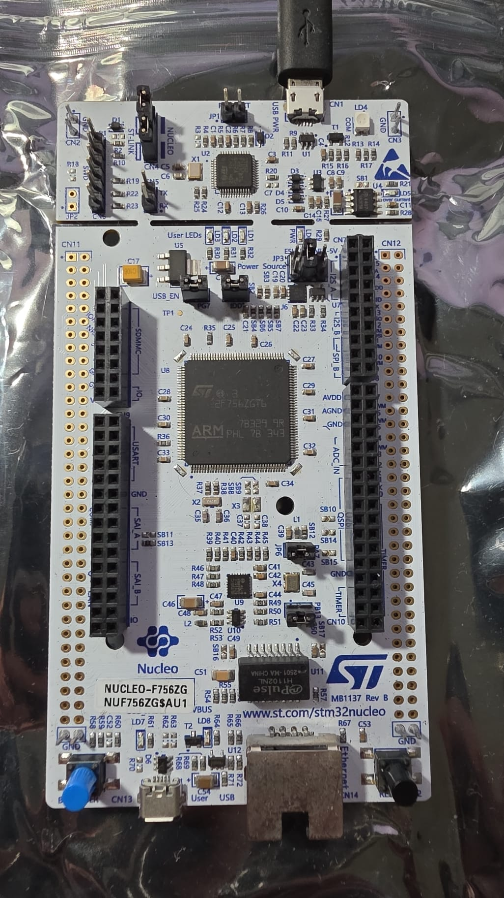
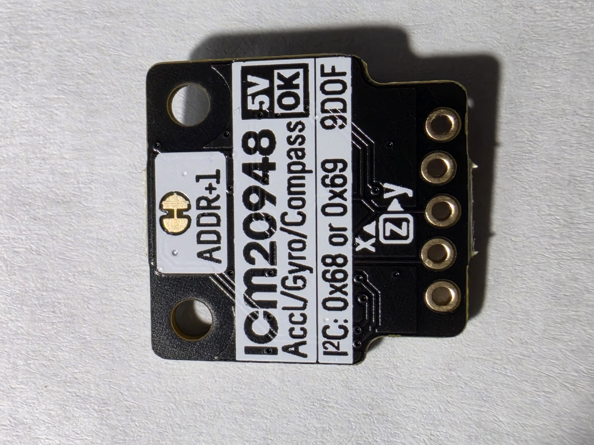
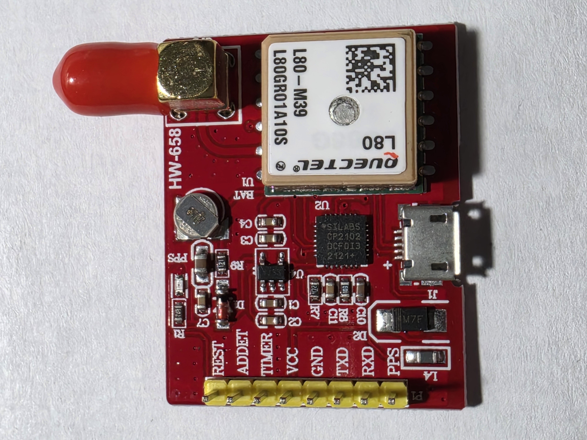
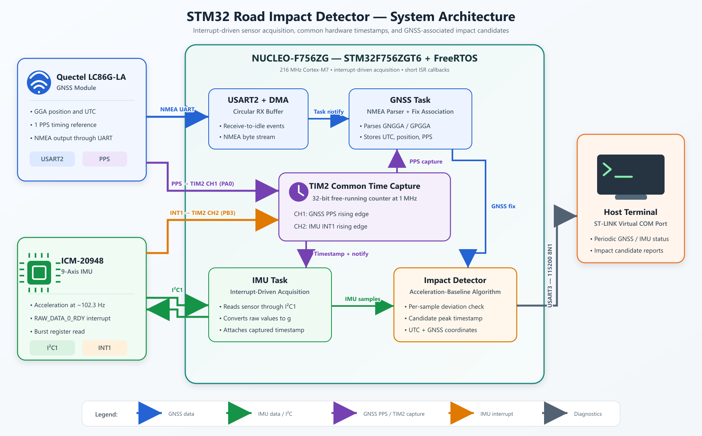
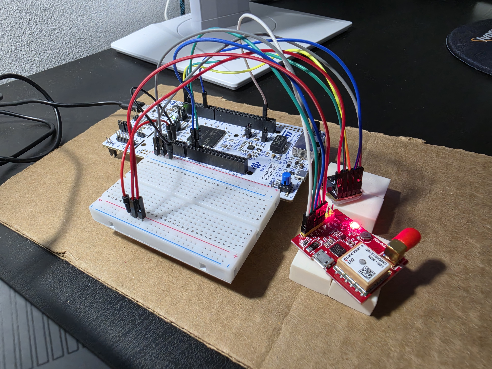
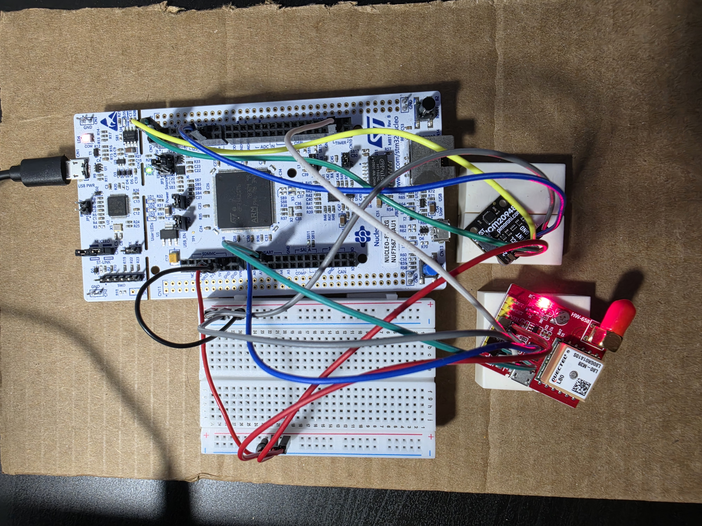
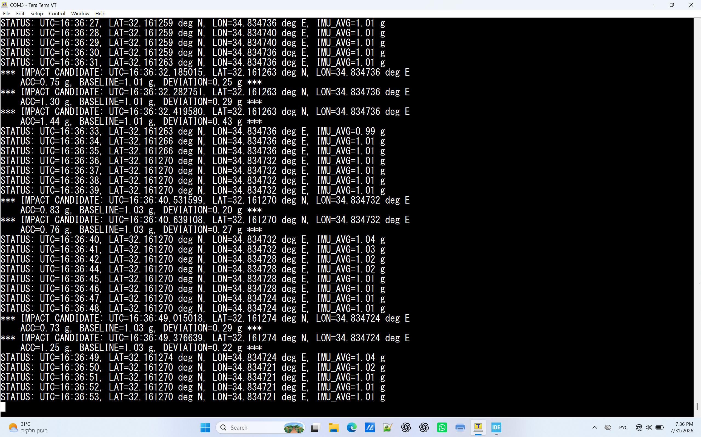

# STM32 Road Impact Detector

## [Real Time Group](https://rt-ed.co.il/) — a multi-disciplinary Real-Time O.S. and Embedded Software Solutions Center, providing consulting, development, integration, training, and support solutions.<br/>

The project implements a real-time road impact detection system based on the STM32F756ZG microcontroller. An ICM-20948 IMU is used to detect impact candidates, while a Quectel LC86G-LA GNSS receiver provides position, time, and a PPS signal for accurate event timestamping.

The system focuses on embedded firmware and does not attempt to classify detected events as potholes, speed bumps, or other specific road features.

---

## Hardware

- STM32 NUCLEO-F756ZG
- Pimoroni ICM-20948 IMU breakout board
- Quectel LC86G-LA GNSS module on an HW-658 development board

> **Important — GNSS module identification**
>
> Although the HW-658 board and its metal shield are marked `L80-M39`, the receiver identifies itself through UART as:
>
> - `$PQTMVER,MODULE,LC86GLANR01A03S,2022/07/01,17:23:16`
> - `$PAIR021,AG3352Q_V2.1.1.AG3352_20220701,...`
>
> These responses identify the installed receiver as a Quectel `LC86G-LA` based on the AG3352Q platform. It accepts the Quectel PAIR command protocol and does not accept the PMTK command set associated with the L80 family. The installed firmware is an older build dated 2022-07-01 and does not support the `$PAIR751` PPS-to-NMEA synchronization command. The project documentation and firmware therefore identify and treat the receiver as an `LC86G-LA`.

| STM32 NUCLEO-F756ZG | Pimoroni ICM-20948 | Quectel LC86G-LA GNSS |
|:---:|:---:|:---:|
|  |  |  |

---

## Technologies

- C
- STM32 HAL
- FreeRTOS
- CMSIS-RTOS V1
- I²C
- UART
- Hardware Timers and Input Capture
- GNSS NMEA and PPS

---

## System Architecture

<p align="center">
  
</p>

The firmware separates sensor acquisition, hardware timestamp capture, impact-candidate detection, and diagnostic output into dedicated components.

The Quectel LC86G-LA supplies two complementary data streams. NMEA sentences are received through USART2 using circular DMA and parsed by the GNSS task to obtain UTC, position, and fix validity. The module's PPS rising edge is captured independently by TIM2 channel 1 and provides the precise second boundary used to associate NMEA data with the local timer.

The ICM-20948 is accessed through I²C1. When a new raw measurement is available, the sensor generates a pulse on its `INT1` output. TIM2 channel 2 captures the rising edge in hardware, and the timer callback notifies the IMU task. The task then reads the sensor registers, converts the raw acceleration to units of g, and attaches the captured timestamp to the measurement.

TIM2 is a free-running 32-bit counter configured at 1 MHz. Capturing both GNSS PPS and IMU `INT1` with the same timer provides a common one-microsecond time base. Measurement timestamps therefore do not depend on FreeRTOS scheduling latency or the duration of the subsequent I²C transaction.

The impact detector evaluates each acceleration sample against a moving baseline. When an impact candidate is completed, its peak TIM2 timestamp is associated with the corresponding GNSS fix and PPS capture to produce a PPS-referenced UTC timestamp and geographic coordinates. Periodic status and candidate reports are sent through USART3 using the ST-LINK Virtual COM Port.

---

## Current Implementation

- Separate FreeRTOS tasks for the Quectel LC86G-LA GNSS receiver and the ICM-20948 inertial measurement unit (IMU)
- Quectel LC86G-LA NMEA reception through USART2 with circular DMA
- Position and UTC parsing from the GNSS `$GNGGA` and `$GPGGA` NMEA sentences
- Quectel LC86G-LA PPS timing-signal capture through TIM2 channel 1
- ICM-20948 IMU detection at I²C addresses `0x68` and `0x69` with `WHO_AM_I` identity verification
- ICM-20948 IMU accelerometer and gyroscope configuration at approximately 102.3 Hz
- Measurement-ready signaling through the ICM-20948 IMU `INT1` output
- Hardware capture of each IMU `INT1` rising edge through TIM2 channel 2
- Burst reading of raw acceleration, angular velocity, and internal temperature from the ICM-20948 through I²C1
- ICM-20948 accelerometer full-scale detection and conversion of raw measurements to units of g
- Three-axis IMU acceleration magnitude calculation for impact-candidate detection
- Common 1 MHz TIM2 timestamps for Quectel GNSS PPS and ICM-20948 IMU `INT1` events
- PPS-based UTC synchronization of ICM-20948 IMU measurements
- Moving acceleration baseline and impact-candidate detection
- Association of impact candidates with Quectel GNSS UTC and position data
- Automatic I²C recovery after ICM-20948 IMU communication errors
- Thread-safe serial diagnostics through the ST-LINK Virtual COM Port

---

## Prototype and Field Test

The complete prototype was tested outdoors with simultaneous ICM-20948 measurement acquisition, GNSS NMEA reception, PPS capture, and serial diagnostic output. A valid Quectel LC86G-LA GNSS fix was maintained while controlled movement of the prototype produced impact candidates.

| Complete prototype | Top view |
|:---:|:---:|
|  |  |

### Field-Test Video

The video shows the operating prototype, the live serial terminal, and impact candidates generated by controlled movement of the system:

▶ **[Watch the outdoor field-test video](Docs/Images/road-impact-detector-field-test.mp4)**

### Diagnostic Output

<p align="center">
  
</p>

The `STATUS` line is printed at most once per second. It reports the PPS-referenced UTC time, GNSS latitude and longitude, and the current moving IMU acceleration baseline (`IMU_AVG`). Small changes in the last coordinate digits are normal GNSS position variation while the prototype is stationary.

An `IMPACT CANDIDATE` message is printed when a candidate is completed. It contains:

- `UTC`: event time obtained from the associated GNSS second and the TIM2 offset after PPS
- `LAT` and `LON`: position from the associated valid Quectel GNSS fix
- `ACC`: acceleration magnitude at the strongest sample in the candidate
- `BASELINE`: moving acceleration reference used for the detection decision
- `DEVIATION`: absolute difference between the peak acceleration and the baseline

Example captured during the outdoor test:

```text
*** IMPACT CANDIDATE: UTC=16:36:32.282751, LAT=32.161263 deg N, LON=34.834736 deg E
    ACC=1.30 g, BASELINE=1.01 g, DEVIATION=0.29 g ***
```

---

## Impact Candidate Detection

The detector uses the magnitude of the three-axis acceleration vector rather than an individual sensor axis:

`|a| = sqrt(ax² + ay² + az²)`

This makes the initial detection method independent of the orientation of the IMU axes relative to the prototype. Gravity is included, so a stationary sensor normally reports a magnitude close to 1 g.

The current algorithm operates as follows:

1. The first 10 valid IMU samples establish the initial acceleration baseline.
2. After initialization, every individual sample is compared with the current baseline.
3. An absolute deviation of at least `0.20 g` opens an impact candidate immediately.
4. If several samples cross the threshold, the sample with the largest deviation becomes the candidate peak and supplies its acceleration and TIM2 timestamp.
5. Three consecutive below-threshold samples complete the candidate. At approximately 102.3 samples per second, this represents about 29 ms of return toward the baseline.
6. Samples collected while a candidate is active are excluded from baseline updates.
7. Ten eligible normal samples form a baseline-update group. The baseline moves 10% toward the group average instead of being replaced directly.

The output deliberately uses the term *impact candidate*. Acceleration alone cannot reliably classify the detected motion as a pothole, speed bump, road joint, or another specific road feature. The current threshold and baseline parameters are experimental and require controlled road-test validation.

---

## Hardware Connections

| Device | Signal | STM32F756ZG connection | Purpose |
|:---|:---|:---|:---|
| Quectel LC86G-LA GNSS receiver board | VCC | 3V3 | 3.3 V module power supply |
| Quectel LC86G-LA GNSS receiver board | GND | GND | Common ground |
| Quectel LC86G-LA GNSS receiver | TX | PD6 / USART2_RX | NMEA data reception |
| Quectel LC86G-LA GNSS receiver | RX | PD5 / USART2_TX | GNSS command interface |
| Quectel LC86G-LA GNSS receiver | PPS | PA0 / TIM2_CH1 | GNSS second-boundary capture |
| Pimoroni ICM-20948 IMU board | 2-5V | 3V3 | 3.3 V board power supply |
| Pimoroni ICM-20948 IMU board | GND | GND | Common ground |
| ICM-20948 IMU | SCL | PB8 / I²C1_SCL | I²C clock |
| ICM-20948 IMU | SDA | PB9 / I²C1_SDA | I²C data |
| ICM-20948 IMU | INT1 | PB3 / TIM2_CH2 | Measurement-ready timestamp capture |
| NUCLEO-F756ZG / ST-LINK Virtual COM Port | USART3_TX | PD8 | Diagnostic output from the STM32 to the host terminal |
| NUCLEO-F756ZG / ST-LINK Virtual COM Port | USART3_RX | PD9 | Host-to-STM32 serial input |

The documented prototype powers both sensor boards from the NUCLEO `3V3` output, and all connected modules share a common ground. The HW-658 carrier board does not regulate its external `VCC` input to 3.3 V before supplying the GNSS module. **Its `VCC` pin must therefore be connected to the NUCLEO `3V3` output and must not be connected to `5V`.** The LC86G-LA itself has a recommended `VCC` range of 2.55-3.6 V and an absolute maximum of 3.63 V.

---

## Build and Run

1. Open the `STM32RoadImpactDetector` project directory in STM32CubeIDE or import it as an existing STM32 project.
2. Build the project using the provided STM32CubeIDE configuration.
3. Connect the NUCLEO-F756ZG through its ST-LINK USB port and program the firmware.
4. Open the ST-LINK Virtual COM Port in a serial terminal using `115200` baud, 8 data bits, no parity, and 1 stop bit (`115200 8N1`).
5. Place the GNSS antenna where it has a clear view of the sky and wait for a valid position fix and PPS signal.
6. Confirm that periodic `STATUS` messages contain UTC and coordinates instead of `GNSS=UNAVAILABLE`.
7. Apply controlled movement to the prototype and observe the resulting `IMPACT CANDIDATE` messages.

The terminal output is intended for development and validation. The current firmware does not require a host-side application beyond a standard serial terminal.

---

## Documentation

- [Architectural Design Decisions](Docs/Architectural-Design-Decisions.md)
- [ICM-20948 Datasheet](https://invensense.tdk.com/wp-content/uploads/2024/03/DS-000189-ICM-20948-v1.6.pdf)
- [Quectel LC86G Series Hardware Design](https://www.quectel.com/content/uploads/2024/02/Quectel_LC86G_Series_Hardware_Design_V1.1.pdf)
- [Quectel LC26G/LC76G/LC86G Series GNSS Protocol Specification](https://www.quectel.com/content/uploads/2024/04/Quectel_LC26GLC26G-TLC76GLC86G_Series_GNSS_Protocol_Specification_V1.5.pdf)
- [STM32F756xx Datasheet](https://www.st.com/resource/en/datasheet/stm32f756zg.pdf)
- [STM32 Nucleo-144 User Manual UM1974](https://www.st.com/resource/en/user_manual/dm00244518-nucleo-144-boards-mb1137-stmicroelectronics.pdf)

The current firmware is a functional prototype validated with simultaneous IMU acquisition, GNSS NMEA reception, PPS capture, timestamp association, and impact-candidate reporting.


## Author

Ilia Rakhlevski
